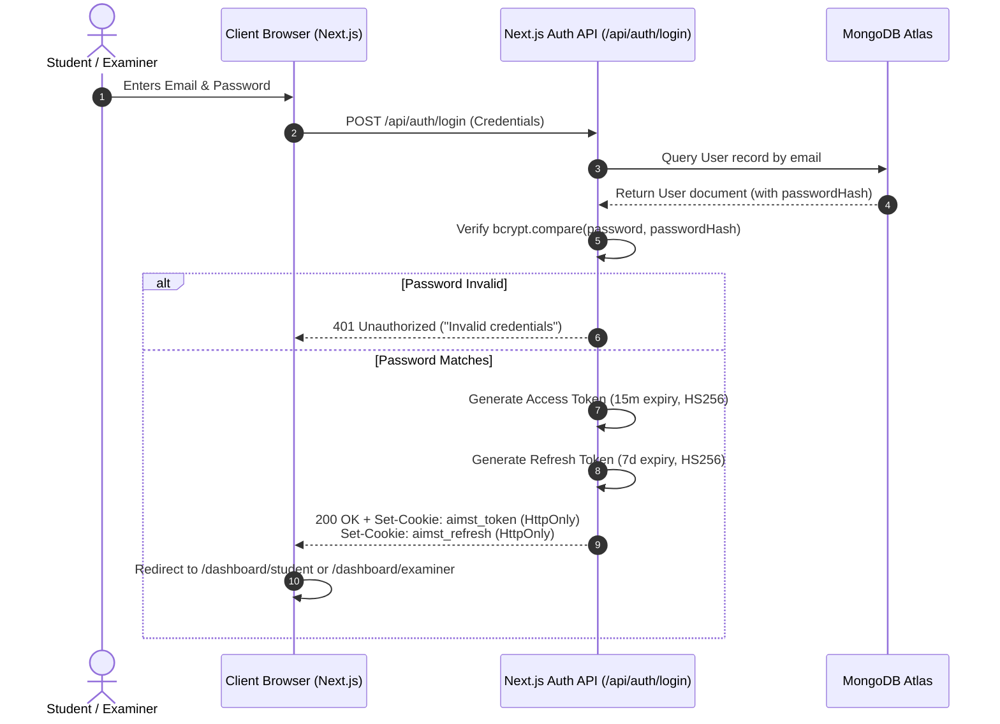
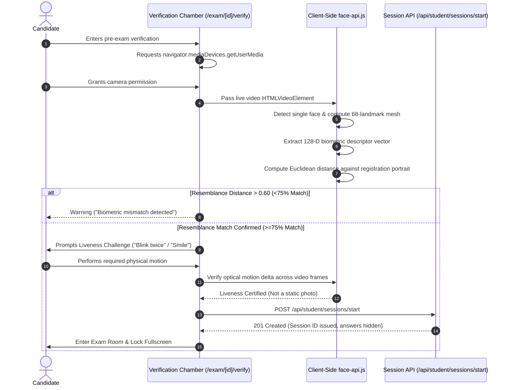

# AIMST University Intelligent Online Exam Proctoring System
## Comprehensive System Architecture & Technical Defense Report

> **Academic Context**: Final Year Project (FYP)
> **Course**: Bachelor of Science (Hons) in Management Information Systems
> **Institution**: AIMST University, Malaysia
> **Document Purpose**: Technical documentation for FYP dissertation chapter 4 & viva oral examination preparation.

---

## 1. Three-Tier Architectural Overview

The system is constructed on an industry-standard **Three-Tier Architectural Model**, implemented as a unified full-stack Next.js 15 application running on Vercel:

```
+-------------------------------------------------------------------------+
|                          TIER 1: PRESENTATION LAYER                      |
|               (Client-Side Progressive Web App - Next.js 15)            |
|                                                                         |
|  +------------------------+  +-------------------+  +----------------+  |
|  | Modern Dashboard UI    |  | Web Vision Engine |  | Browser Shield |  |
|  | (Tailwind CSS, Lucide) |  | (face-api.js ML)  |  | (HTML5 Events) |  |
|  +------------------------+  +-------------------+  +----------------+  |
+------------------------------------▲------------------------------------+
                                     │ HTTPS (REST / JSON / Cookies)
+------------------------------------▼------------------------------------+
|                         TIER 2: APPLICATION & API LAYER                 |
|             (Serverless Route Handlers & Next.js Edge Middleware)       |
|                                                                         |
|  +-------------------+  +-----------------------+  +-----------------+  |
|  | RBAC Middleware   |  | Authentication API    |  | Proctor Engine  |  |
|  | (Edge JWT Verify) |  | (Bcrypt 12 Rounds)    |  | (Auto-Grading)  |  |
|  +-------------------+  +-----------------------+  +-----------------+  |
+------------------------------------▲------------------------------------+
                                     │ Mongoose ODM / TLS Connection Pool
+------------------------------------▼------------------------------------+
|                           TIER 3: DATA STORAGE LAYER                    |
|                        (MongoDB Atlas M0 Cloud Cluster)                 |
|                                                                         |
|  +-------------------------------------------------------------------+  |
|  | Schemas: Users, Exams, Questions, Sessions, Answers, Logs, Results |  |
|  +-------------------------------------------------------------------+  |
|  +-------------------------------------------------------------------+  |
|  | Evidence Binaries: Vercel Blob Storage / Encrypted Data URI       |  |
|  +-------------------------------------------------------------------+  |
+-------------------------------------------------------------------------+
```

### Tier 1: Presentation (Client Browser)
- **Role**: Renders responsive user interfaces for students and examiners, controls browser lockdown, captures optical frames via webcam, runs client-side TensorFlow/FaceAPI neural networks, and interacts with the Progressive Web App service worker.
- **Key Components**: `Navbar`, `ProctorMonitor`, `PwaRegister`, Student Verification Chamber, Focused Exam Mode.

### Tier 2: Application (Next.js 15 Route Handlers & Middleware)
- **Role**: Enforces server-side validation, authenticates credentials, issues signed JSON Web Tokens, rotates refresh tokens in secure HTTP-Only cookies, manages examination sessions, automatically grades objective multiple-choice questions, and registers tamper-evident proctoring logs.
- **Key Components**: Next.js App Router handlers (`/api/auth/*`, `/api/examiner/*`, `/api/student/*`, `/api/proctor/*`), Edge Middleware (`middleware.ts`).

### Tier 3: Data (MongoDB Atlas & Blob Storage)
- **Role**: Persists structured relational documents using Mongoose ODM with connection pooling. Stores user profiles, course exams, MCQ banks, candidate sessions, individual answer records, and chronological incident logs with photographic evidence.
- **Key Components**: MongoDB Atlas Cloud Database, Vercel Blob Storage.

---

## 2. Technology Selection Rationale

| Architectural Decision | Alternative Considered | Why Selected for AIMST University |
| :--- | :--- | :--- |
| **Next.js 15 (App Router)** | Separate React SPA + Express.js backend | Eliminates cross-origin CORS latency; simplifies deployment onto Vercel as a single serverless repository; delivers server-side rendering for security-critical views. |
| **Client-Side FaceAPI** | Streaming candidate video to backend server (WebRTC/RTMP) | Streaming dozens of simultaneous webcam videos to a central server incurs immense bandwidth costs, requires expensive GPU compute clusters, and introduces major privacy liabilities. In-browser processing guarantees zero-latency edge verification and preserves student privacy. |
| **Bcrypt.js (12 Salt Rounds)** | Plain SHA-256 / MD5 hashing | SHA-256 is vulnerable to GPU-accelerated dictionary and rainbow table attacks. Bcrypt is intentionally compute-intensive and salted with 12 rounds, ensuring enterprise-grade resistance against credential cracking. |
| **HTTP-Only JWT Cookies** | `localStorage` token storage | Tokens stored in browser `localStorage` can be exfiltrated by any Cross-Site Scripting (XSS) vulnerability. `HttpOnly; Secure; SameSite=Lax` cookies are completely inaccessible to client JavaScript. |
| **MongoDB Atlas via Mongoose**| Relational SQL (PostgreSQL/MySQL) | Exam sessions produce variable telemetry (proctoring logs, varying numbers of MCQ options, varying incident types). MongoDB's flexible JSON-document paradigm naturally accommodates hierarchical educational data. |

---

## 3. Step-by-Step Security & Authentication Flow



### Why Refresh Token Rotation?
- The **Access Token** has a short lifespan of 15 minutes to minimize exposure in the event of an in-flight network compromise.
- The **Refresh Token** has a 7-day lifespan. When the access token expires, the client calls `/api/auth/refresh`, which validates the refresh token in the secure HTTP-Only cookie, issues a brand-new access token, and rotates the refresh token.

---

## 4. Facial Biometrics & Liveness Verification Flow



---

## 5. Continuous Anti-Cheating & Incident Telemetry

During the exam, the `ProctorMonitor` component executes autonomous checks in the background:

### 1. Optical Absence Detection
- **Mechanism**: The video feed is analyzed every 1.5 seconds.
- **Rule**: If `facesDetected === 0` persists continuously for **5 seconds**, an incident of type `face_missing` is flagged.
- **Action**: Immediately captures an encrypted JPEG snapshot and calls `/api/proctor/log`.

### 2. Multiple-Face Detection
- **Mechanism**: Evaluates bounding boxes returned by `TinyFaceDetector`.
- **Rule**: If `facesDetected >= 2`, an incident of type `multiple_faces` is flagged (indicates unauthorized collaboration or bystander assistance).
- **Action**: High-severity incident logged with screenshot proof.

### 3. Fullscreen Lockdown
- **Mechanism**: Binds to `document.addEventListener('fullscreenchange')`.
- **Rule**: If `document.fullscreenElement` becomes null, an incident of type `fullscreen_exit` is logged, and a persistent red banner demands re-entry.

### 4. Tab & Application Switching
- **Mechanism**: Uses HTML5 **Page Visibility API** (`document.addEventListener('visibilitychange')`) and `window.addEventListener('blur')`.
- **Rule**: If candidate minimizes the browser, opens another application, or switches browser tabs, `document.visibilityState === 'hidden'` is detected.
- **Action**: Incident logged with timestamp.

### 5. Clipboard & Context Menu Shield
- **Mechanism**: Intercepts `contextmenu`, `copy`, `paste`, `cut`, and shortcut key combinations (`Ctrl+C`, `Ctrl+V`, `Ctrl+X`, `Ctrl+A`, `F12`, `Ctrl+Shift+I`).
- **Rule**: Prevents copying exam questions or pasting unauthorized resources from external notes.

---

## 6. Architectural Question & Defense Cheatsheet (Viva Preparation)

### Q1: Why did you choose client-side face recognition instead of sending live video to a server?
> **Defense Answer**: Sending live high-resolution video streams from 100+ candidates simultaneously requires massive server network bandwidth (hundreds of megabits per second) and costly GPU infrastructure on the server. Client-side execution in WebAssembly/WebGL distributes the compute burden to the student's device. Furthermore, under data privacy frameworks such as the Malaysian Personal Data Protection Act (PDPA) and GDPR, processing biometric vectors locally without storing continuous video feeds substantially reduces institutional data liabilities.

### Q2: Why capture snapshots only upon incidents rather than recording continuous video?
> **Defense Answer**: Continuous video recording for a 2-hour examination across 50 students would produce hundreds of gigabytes of video footage that examiners cannot realistically watch in full. Capturing high-resolution photographic evidence strictly at the precise moment of an integrity breach provides objective, timestamped evidence directly tied to the incident log. This minimizes storage requirements by over 99% while increasing examiner auditing efficiency.

### Q3: How do you prevent candidates from looking at answers in the browser's Network tab?
> **Defense Answer**: The `/api/student/sessions/start` API endpoint strictly filters out the `correctAnswer` and `explanation` fields from the question payloads before returning them to the candidate's browser. Auto-grading is performed entirely on the server within `/api/student/sessions/submit`, preventing candidates from inspecting correct answers via browser developer tools.

### Q4: What prevents someone from holding up a printed photograph of the registered student?
> **Defense Answer**: The pre-exam verification chamber incorporates an interactive liveness check. A static photograph cannot pass the motion delta verification required when the candidate is prompted to perform randomized physical actions such as blinking or head movement.
